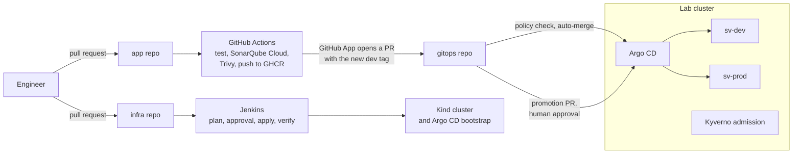

# Sorted Vintage

A peer-to-peer resale marketplace running on a Kubernetes platform that is built, changed and rebuilt only from Git. The marketplace is the workload; the platform is the project. Its goal, over six projects, is a platform that detects, diagnoses and safely fixes its own incidents, with every AI claim scored against labeled failures.

**Status (2026-11-10):** Project 1 of 6 (the marketplace and its platform), Sprint 2 of 3, 55 of 123 tasks done. The platform and delivery path are running; two of five services are deployed. The AIOps work starts in Project 2 and is not built yet.

| Repo | Role |
| --- | --- |
| **sorted-vintage-infra** (this one) | Terraform, Jenkins pipeline, ADRs, runbooks, specs, sprint plans and the verification log |
| [sorted-vintage-app](https://github.com/Rclaye/sorted-vintage-app) | Service code and the GitHub Actions build pipeline |
| [sorted-vintage-gitops](https://github.com/Rclaye/sorted-vintage-gitops) | Desired state that Argo CD applies to the cluster, and the Kyverno policies |

## How a change reaches production



No pipeline holds cluster credentials. CI can only write to Git, Argo CD is the only thing that writes to the cluster, and a rollback is a `git revert` ([ADR-0002](docs/adr/0002-git-is-the-only-path-to-the-cluster.md)).

## What is running

- **Platform, all from Git:** Argo CD (30 applications, all Synced and Healthy), Traefik, cert-manager, Kyverno, Keycloak with realms applied from Git, CloudNativePG Postgres with WAL archiving and scheduled backups, RabbitMQ, Garage (S3), Prometheus, Grafana, Alertmanager, Loki, Tempo and an OpenTelemetry Collector.
- **Environments:** `sv-dev` and `sv-prod`, each with its own data stores, generated from the gitops folder layout by an ApplicationSet.
- **Services:** `bff` (FastAPI) and `listings` (Spring Boot) in dev and prod, each with health and metrics endpoints, JSON logs and traces. Orders, payments and notifications come in Sprint 3.
- **Hardware and cost:** one 16 GB arm64 machine, $0 recurring ([ADR-0001](docs/adr/0001-local-kind-instead-of-eks.md)).

## Measured so far

Every acceptance check is recorded in the [verification log](docs/verification-log.md) with how it was run, the result, the date and the evidence. Open and partial checks are listed there too.

| What | Result | Where |
| --- | --- | --- |
| Start the lab from stopped to every application healthy | 75 s, with data and telemetry history intact (target: under 10 minutes) | [Ticket 1.6](docs/verification-log.md#ticket-16-working-sessions) |
| Policy holds at admission and in CI | 6 of 6 bad manifests rejected, 3 of 3 good ones accepted; a pull request with an image from outside the registry failed its policy check | [Ticket 1.4](docs/verification-log.md#ticket-14-policy-at-admission-and-in-ci) |
| Drift is repaired | A Deployment deleted by hand was recreated in 0.6 s; HTTPS was back in 1.4 s | [Ticket 1.3](docs/verification-log.md#ticket-13-platform-add-ons-by-argo-cd) |
| Prod needs a person | A promotion PR could not merge without approval; `git revert` returned prod to its previous version | [Ticket 1.5](docs/verification-log.md#ticket-15-service-template-and-the-delivery-path) |
| Backups restore | Base backup and WAL archive restored into a new cluster with all rows, databases and roles | [Ticket 1.3](docs/verification-log.md#ticket-13-platform-add-ons-by-argo-cd) |
| Memory against plan | 6.16 GiB of pods measured against a 9.5 GB plan | [Sprint 1 retro](sprints/sprint-1/sprint1_retro.md) |

Not measured yet: the full rebuild from an empty machine (target: under 30 minutes), checkout latency and trace coverage of a purchase. They are planned for the end of Project 1.

## Where to look

1. [Constitution](.specify/memory/constitution.md): the eight rules every change follows.
2. [ADR-0001](docs/adr/0001-local-kind-instead-of-eks.md), [ADR-0002](docs/adr/0002-git-is-the-only-path-to-the-cluster.md) and [ADR-0008](docs/adr/0008-jenkins-on-the-air-and-sonarqube-cloud.md): the main decisions and what they cost.
3. [Verification log](docs/verification-log.md): what was checked and how.
4. [Sprint 1 retro](sprints/sprint-1/sprint1_retro.md) and the spike notes ([Sprint 1](sprints/sprint-1/spikes.md), [Sprint 2](sprints/sprint-2/spikes.md)): what went wrong and what changed because of it.
5. [Spec](specs/001-marketplace-local-cloud/spec.md), [plan](specs/001-marketplace-local-cloud/plan.md) and [tasks](specs/001-marketplace-local-cloud/tasks.md) for Project 1.
6. The pipelines: [build.yml](https://github.com/Rclaye/sorted-vintage-app/blob/main/.github/workflows/build.yml) in the app repo, [promote.yml](https://github.com/Rclaye/sorted-vintage-gitops/blob/main/.github/workflows/promote.yml) and [prod-gate.yml](https://github.com/Rclaye/sorted-vintage-gitops/blob/main/.github/workflows/prod-gate.yml) in the gitops repo, and the [Jenkinsfile](jenkins/Jenkinsfile) here.

## Layout

```text
.specify/            Spec Kit: constitution (memory/), templates, scripts and workflows
specs/               Spec Kit features: spec, plan and tasks per project
sprints/sprint-N/    Sprint spec, verify script and retro
docs/adr/            Architecture decision records
docs/runbooks/       Operating procedures
scripts/             Lab setup and audit scripts
terraform/           Cluster and bootstrap roots (from Sprint 1)
```

## Set up a machine

```bash
brew bundle --file scripts/Brewfile
```

The [Brewfile](scripts/Brewfile) lists the toolchain. The remaining setup steps are in [Sprint 0](sprints/sprint-0/sprint0.md), Tickets 0.3 and 0.4.

The Spec Kit workspace was created with Specify CLI 1.2.5 (sh scripts; options in `.specify/init-options.json`). The CLI is only needed to upgrade it; the scripts run without it. Spec Kit records the active feature in `.specify/feature.json`, which is git-ignored, so on a fresh clone set it per shell:

```bash
export SPECIFY_FEATURE_DIRECTORY=specs/001-marketplace-local-cloud
```
