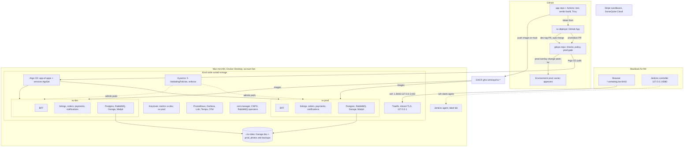
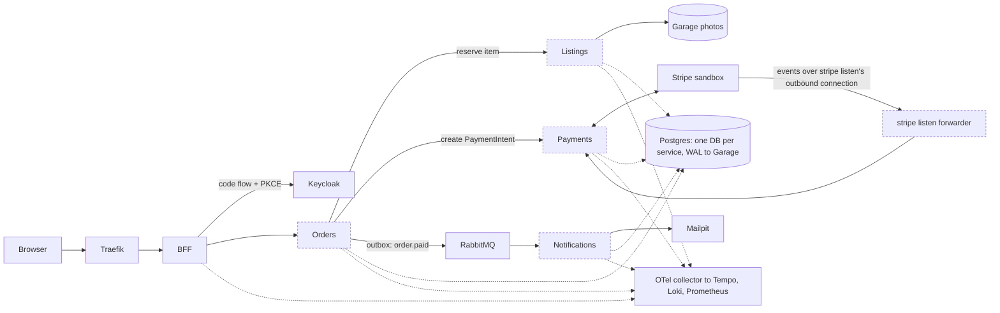

# Sorted Vintage architecture

State as of Sprint 1, Ticket 1.5 (2026-11-05). Dashed nodes are planned and not built yet:
Jenkins and SonarQube Cloud (Ticket 1.7), and every app service except the BFF (Sprint 2).
Update this file when a planned part is built.

## 1. Platform view

Delivery path: a merge to the app repo builds and scans the image, pushes it to GHCR, and the
`sv-deployer` App opens a pull request that sets the dev tag; it merges itself once the checks
pass. `promote.yml` opens the promotion pull request, which waits for the owner's approval in the
`prod` environment. Rollback is `git revert` through the same gate (ADR-0002).

## 2. Purchase request and data flow (planned, Sprint 2)

Only the BFF and the data stores exist today; the services and their calls are the plan.

Notes: the `trace_id` follows the order through RabbitMQ via `traceparent` (research R9). Stripe
events missed while the lab is off are recovered by reconciliation (R5). No port is opened for
webhooks: the forwarder runs inside the cluster and connects out to Stripe (R4).
